# SaigeAI

**AI-powered job search, resume optimization, profile management and application command center.**

<p align="center">
  <a href="https://saige-ai.vercel.app"><b>Live app</b></a> ·
  <a href="https://saige-ai.vercel.app/download"><b>Android app & Chrome extension</b></a> ·
  <a href="docs/ARCHITECTURE.md"><b>Architecture</b></a>
</p>

## Demo

<p align="center">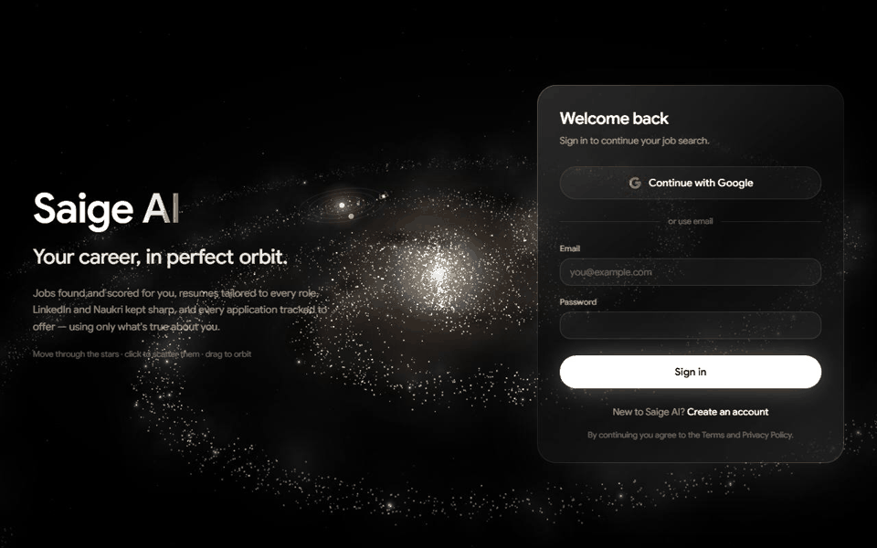</p>

<details open>
<summary><b>Screenshots</b></summary>

<table>
<tr><td align="center">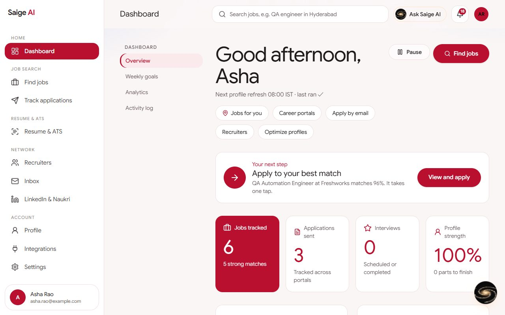<br/><b>Dashboard</b></td><td align="center">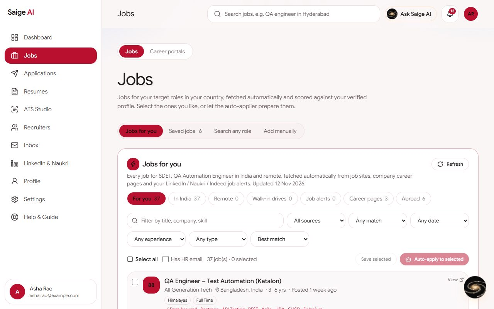<br/><b>Jobs for you</b></td></tr>
<tr><td align="center">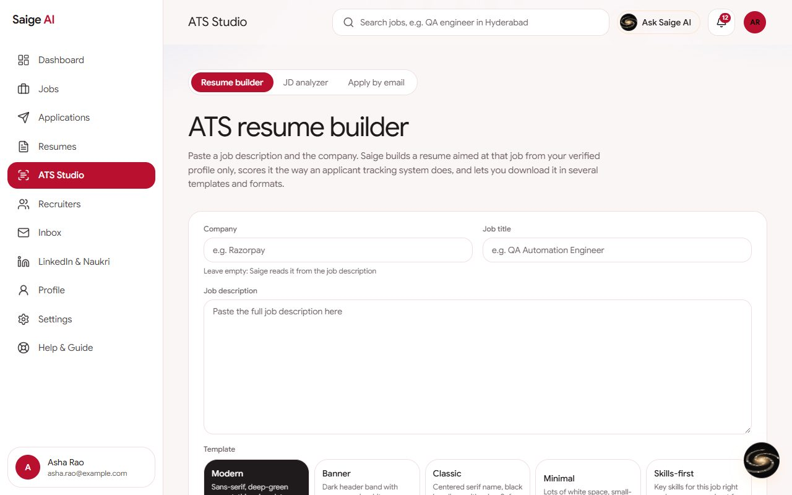<br/><b>Resume builder & ATS score</b></td><td align="center">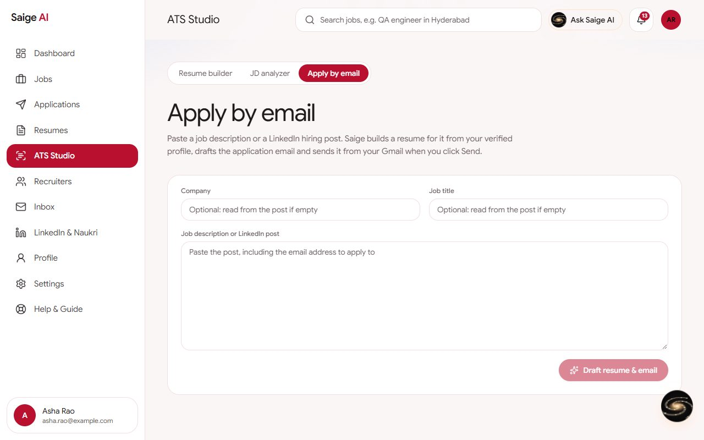<br/><b>Apply by email</b></td></tr>
<tr><td align="center">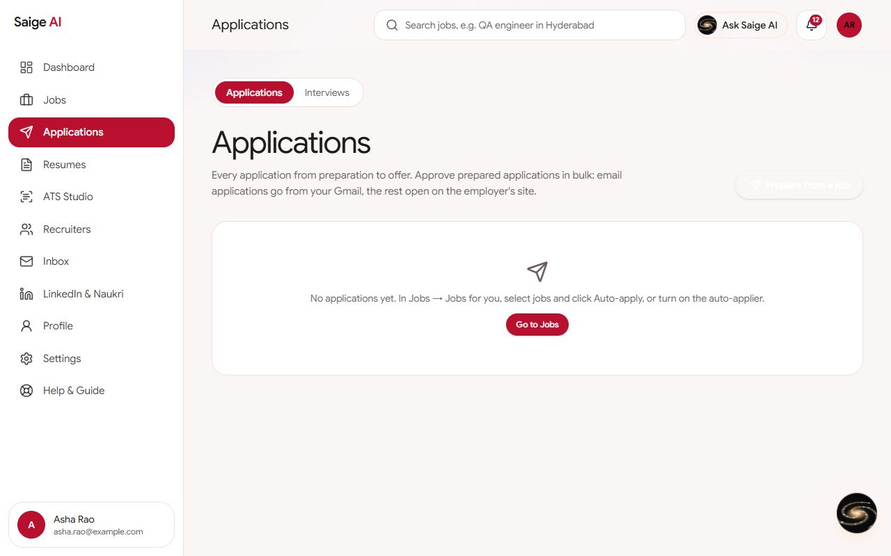<br/><b>Application tracker</b></td><td align="center">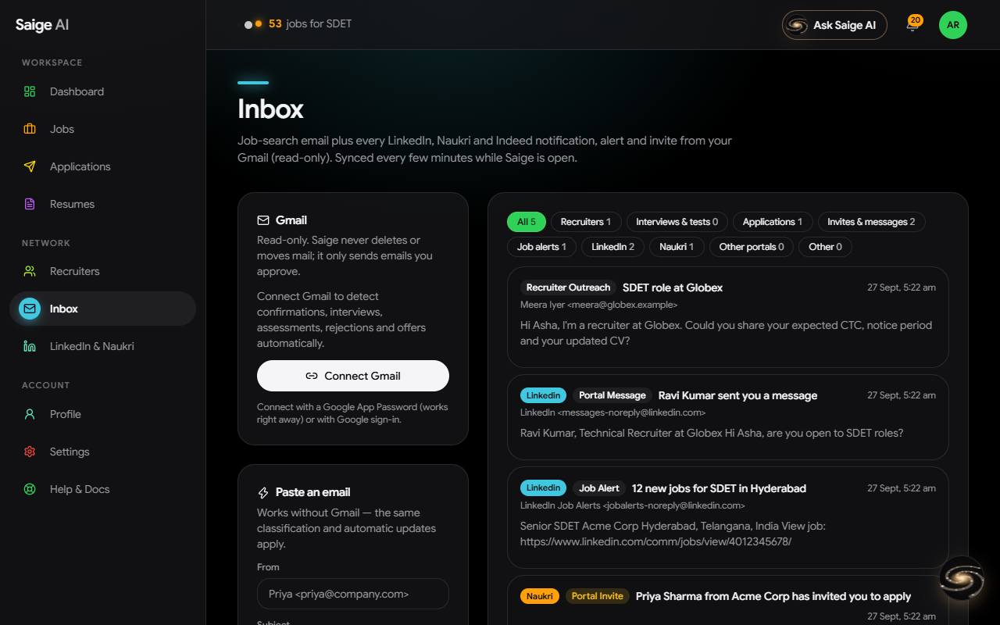<br/><b>Inbox (Gmail)</b></td></tr>
<tr><td align="center">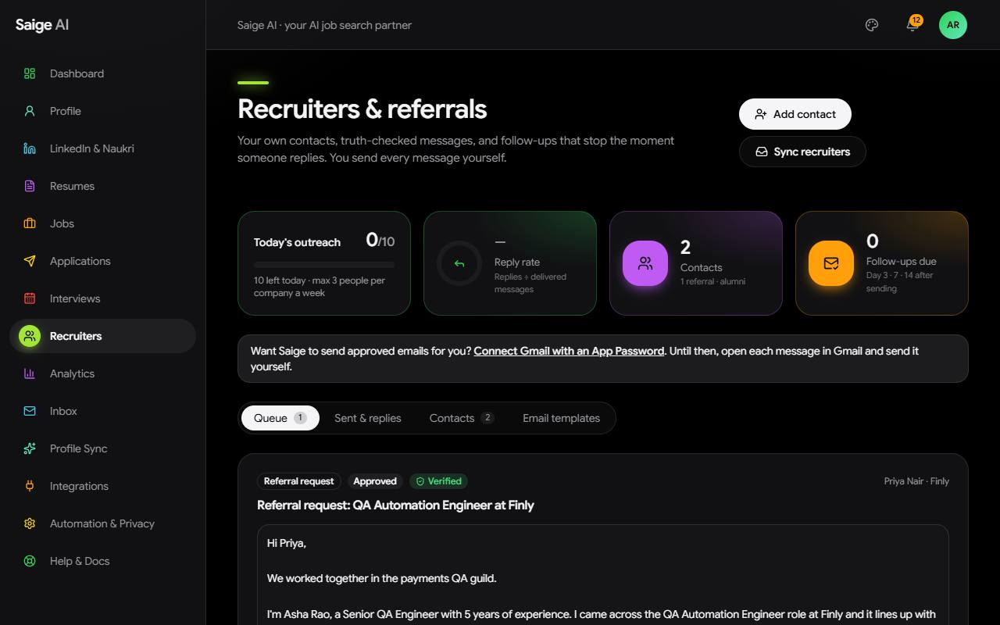<br/><b>Recruiters & outreach</b></td><td align="center">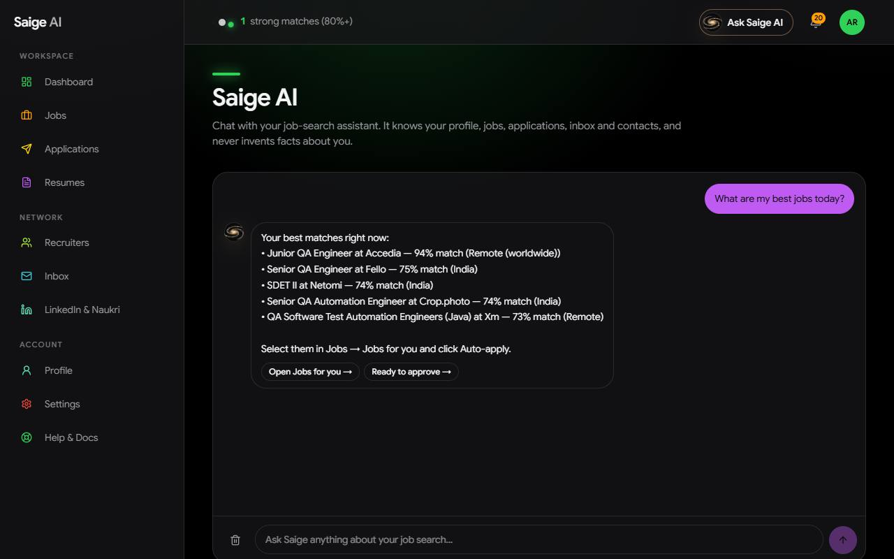<br/><b>Saige assistant</b></td></tr>
<tr><td align="center">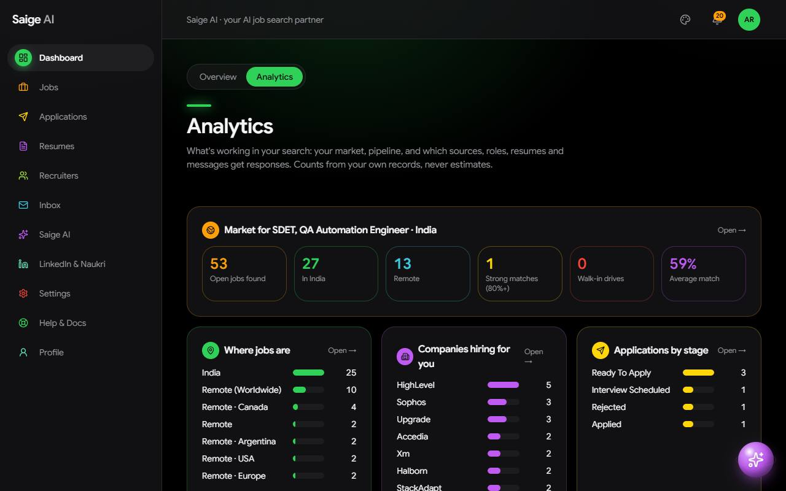<br/><b>Analytics</b></td><td align="center">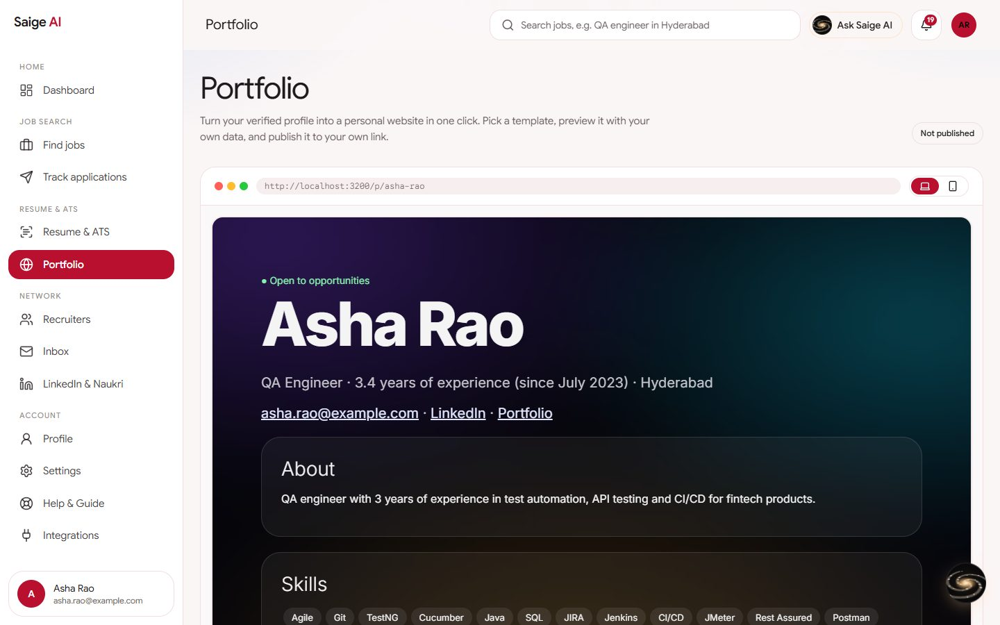<br/><b>Portfolio builder</b></td></tr>
</table>

</details>

Saige AI is a personal career automation platform. It keeps a verified master profile and uses
it to discover and match jobs, tailor resumes, track applications and monitor recruiter email.
Two rules hold across every module:

1. **It never makes things up.** Everything it generates is checked against the candidate's
   verified knowledge base. If a claim can't be traced there, the result is
   `VALIDATION FAILED` and the action is blocked.
2. **It follows platform rules.** It uses official APIs, OAuth and user-provided data only.
   There is no CAPTCHA or anti-bot bypass, no unauthorized scraping, and no storing of
   third-party passwords or OTPs.

## Status

The build is incremental, following the 8 phases in the product spec.

| Phase | Scope | Status |
|---|---|---|
| 1. Foundation | Auth (email/password, Google OAuth, JWT + rotating refresh tokens), master profile & knowledge base, MongoDB, resume upload/parse/versioning, dashboard | **Done** |
| 2. Job Intelligence | Paste-JD and ATS URL import, official Greenhouse/Lever/Ashby board sync, JD analysis, configurable match scoring, cross-source duplicate merging, jobs dashboard | **Done** |
| 3. Resume AI | JD-tailored resumes, cover letters, ATS checks | Planned |
| 4. Application Tracking | Tracker, application questions, interviews | Planned |
| 5. Gmail | OAuth, sync, classification, status updates | Planned |
| 6. Recruiter Outreach | Discovery, cold email, follow-ups | Planned |
| 7. Profile Automation | LinkedIn / Naukri analysis, daily optimization | Planned |
| 8. Advanced Automation | Agents, scheduler, permitted auto-apply | Planned |

Phase 1 also includes groundwork that later phases depend on:

- **Truthfulness guard** (`backend/app/services/truth_guard.py`)
- **Emergency controls:** pause all automation, or pause individual capabilities
- **Audit log** with secrets redacted
- **Notifications**
- **Privacy:** export my data, delete my account

## Tech stack

- **Frontend:** Next.js, TypeScript, React, Tailwind CSS, shadcn/ui-style components, Recharts
- **Backend:** Python 3.12, FastAPI, Pydantic v2, Motor (MongoDB)
- **Database:** MongoDB Atlas, configured through `MONGODB_URI`

## Repository layout

```text
backend/        FastAPI app (app/<module>/{router,service}.py) + pytest suite
frontend/       Next.js dashboard
docker/         Dockerfiles
docs/           Architecture & design notes
workers/        Background workers (Phase 8)
scripts/        Utility scripts
```

## Getting started

### 1. Configure

```bash
cp .env.example .env
# fill in MONGODB_URI and JWT_SECRET (generate one with the command in .env.example)
```

`.env` is git-ignored. Never commit real credentials.

### 2. Backend

```bash
cd backend
python -m venv .venv
.venv/Scripts/activate            # Windows  (macOS/Linux: source .venv/bin/activate)
pip install -r requirements-dev.txt
uvicorn app.main:app --reload --port 8000
```

API docs are at http://localhost:8000/api/docs. They are disabled when `ENVIRONMENT=production`.

### 3. Frontend

```bash
cd frontend
npm install
npm run dev                       # http://localhost:3000 (proxies /api/* to BACKEND_URL)
```

If port 3000 is already taken (for example by Grafana), run `npm run dev -- -p 3100`. Then set
`FRONTEND_URL`, `CORS_ORIGINS` and `GOOGLE_REDIRECT_URI` in `.env` to the new port.

### Windows one-liner

```powershell
powershell -ExecutionPolicy Bypass -File scripts\dev.ps1   # backend :8000 + frontend :3100
```

### Or with Docker

```bash
docker compose up --build         # mongo + backend + frontend
```

## Tests

```bash
cd backend && pytest -q           # unit + API tests against an in-memory Mongo mock
cd frontend && npm test
```

The backend suite includes explicit **hallucination tests**
(`tests/test_hallucination_guard.py`). They check that the guard blocks each of these kinds of
fabricated content:

- company
- job title
- project
- certification
- skill
- years of experience
- salary
- achievement metric
- education

## API (Phase 1)

All routes are prefixed with `/api`.

| Area | Endpoints |
|---|---|
| Auth | `POST /auth/register`, `POST /auth/login`, `POST /auth/refresh`, `POST /auth/logout`, `GET /auth/me`, `GET /auth/connections`, `GET /auth/google/authorize`, `GET /auth/google/callback` |
| Profile | `GET /profile`, `PUT /profile`, `POST /profile/validate-claims` |
| Resumes | `GET/POST /resumes`, `GET/PUT/DELETE /resumes/{id}`, `POST /resumes/{id}/duplicate`, `/archive`, `/unarchive`, `GET /resumes/{id}/versions`, `/compare?a=&b=`, `/download`, `POST /resumes/{id}/import-to-profile` |
| Jobs | `GET /jobs`, `GET /jobs/{id}`, `POST /jobs/import`, `POST /jobs/import-url`, `POST /jobs/{id}/match`, `POST /jobs/{id}/status`, `DELETE /jobs/{id}`, `POST /jobs/rematch-all`, `GET/PUT /jobs/matching/config`, `GET/POST /jobs/sources`, `DELETE /jobs/sources/{id}`, `POST /jobs/sources/{id}/sync` |
| Dashboard | `GET /analytics/dashboard`, `GET /automation/runs` |
| Automation | `GET /automation/status`, `PUT /automation/settings`, `POST /automation/pause-all`, `POST /automation/resume-all` |
| Notifications | `GET /notifications`, `POST /notifications/{id}/read` |
| Privacy | `GET /privacy/export`, `DELETE /privacy/account`, `DELETE /privacy/profile-history`, `GET /audit` |

## Security summary

- **Passwords:** hashed with bcrypt.
- **Access tokens:** short-lived JWTs held in memory by the frontend.
- **Refresh tokens:** opaque and stored hashed. They live in an `HttpOnly`, `SameSite=Strict`
  cookie scoped to `/api/auth`. Each refresh rotates the token, and reusing an old token
  revokes the whole session family.
- **CSRF:** endpoints authenticated by cookie also require the `X-Requested-With` header.
- **Rate limiting:** applied to auth and upload endpoints.
- **Uploads:** type is checked by extension, content-type and magic bytes, with a size limit.
- **Isolation:** every query is scoped to the authenticated user.
- **Headers and logs:** security headers on every response, and structured JSON logs with
  request IDs. Credentials are never logged.

See [docs/ARCHITECTURE.md](docs/ARCHITECTURE.md) for design decisions and [docs/DEPLOYMENT.md](docs/DEPLOYMENT.md) for hosting (Vercel + Render + Atlas).
